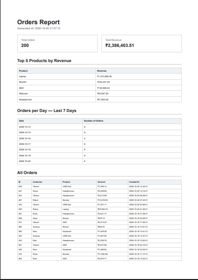

# PDF Report Generator

A Python-based PDF Report Generator built with FastAPI, SQLite, HTML, and Playwright.

The application queries order data from SQLite, generates a formatted PDF report using HTML and Chromium, stores the report on disk, and exposes API endpoints to retrieve and download reports.

The sample dataset can be regenerated locally at any time by running python seed.py.

## Features

- FastAPI REST API
- SQLite database containing 200 sample orders
- SQL aggregation for order counts and revenue
- Top 5 products ranked by revenue
- Daily order counts for the last 7 days
- HTML-to-PDF generation using Playwright and Chromium
- PDF files saved locally
- Report metadata stored in SQLite
- API endpoints for generating, retrieving, and downloading reports
- Same-day report reuse to prevent repeated sequential generation

## Technology Stack

- Python
- FastAPI
- SQLite
- Playwright
- Chromium
- HTML and CSS
- Git and GitHub

## Project Structure

```text
flyrank-pdf-report-generator/
├── main.py
├── seed.py
├── report_data.py
├── pdf_generator.py
├── report.db
├── reports/
│   └── test.pdf
├── .gitignore
└── README.md

## PDF Preview

